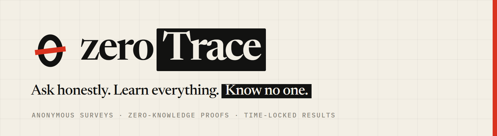
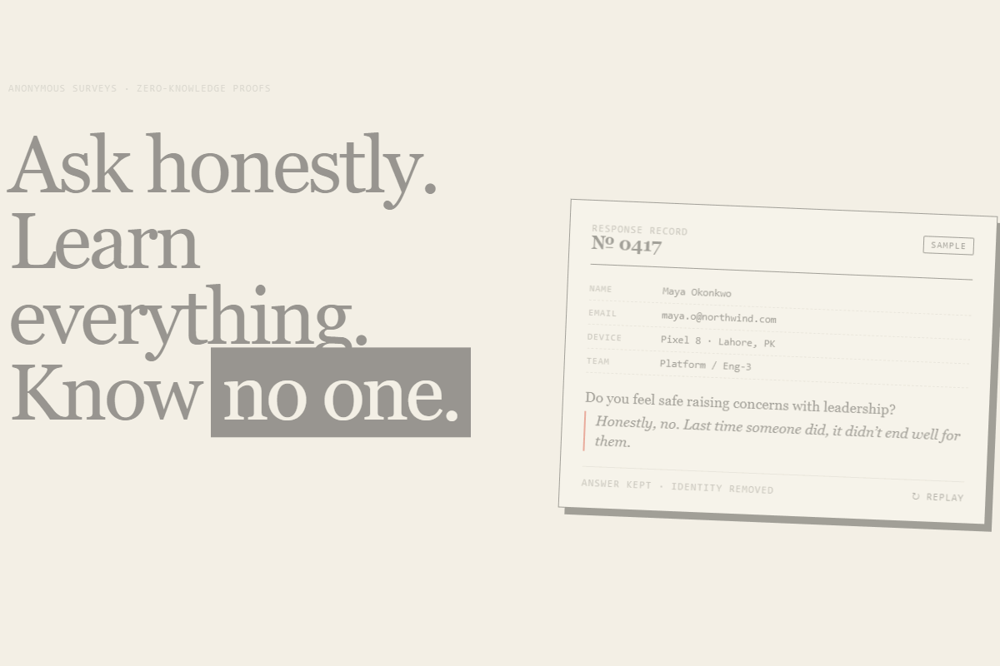
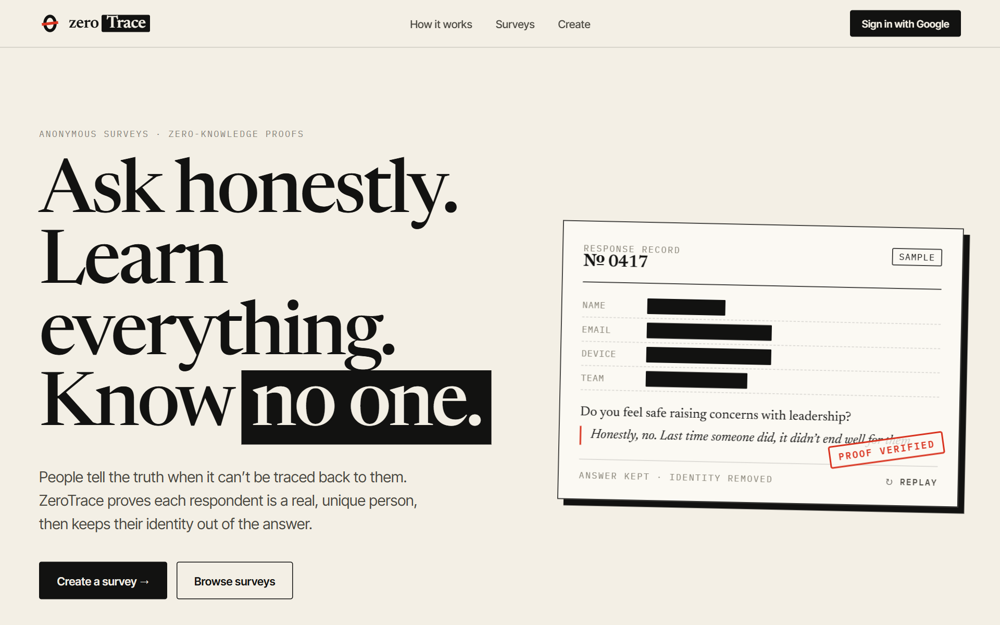
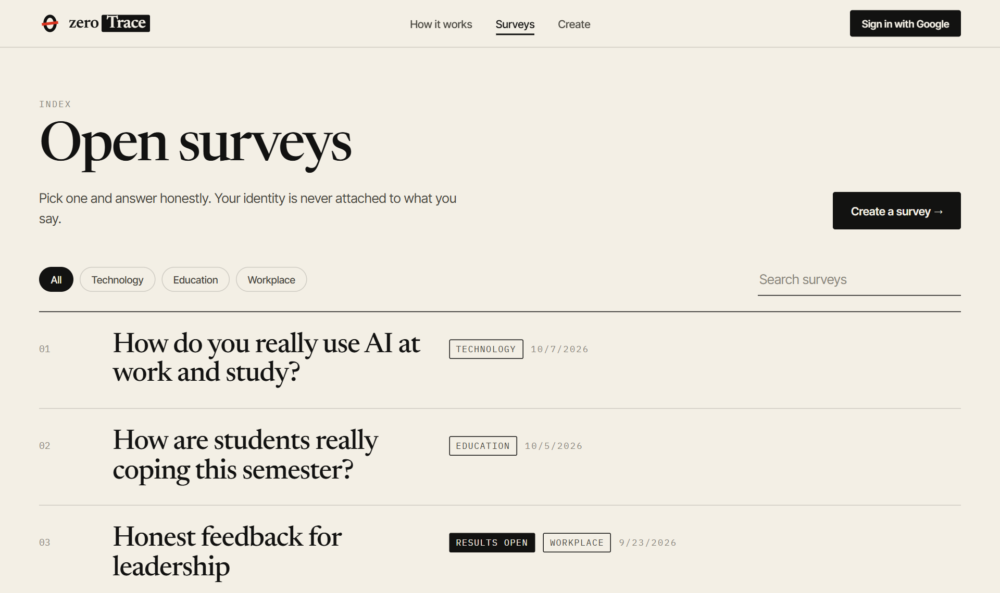
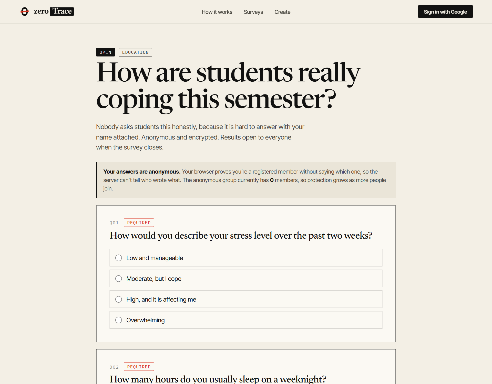
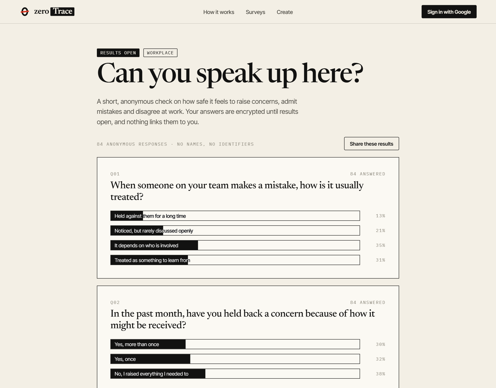
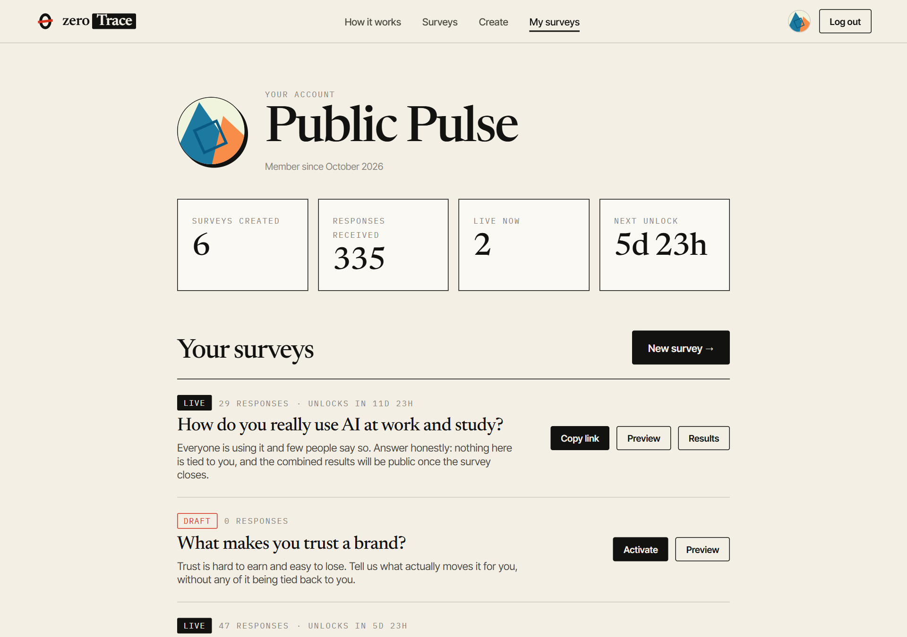
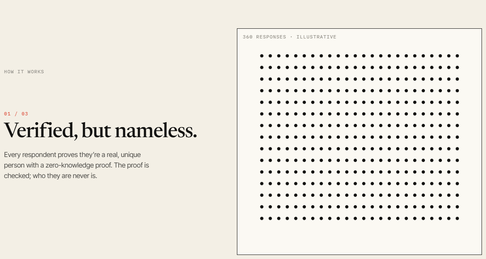
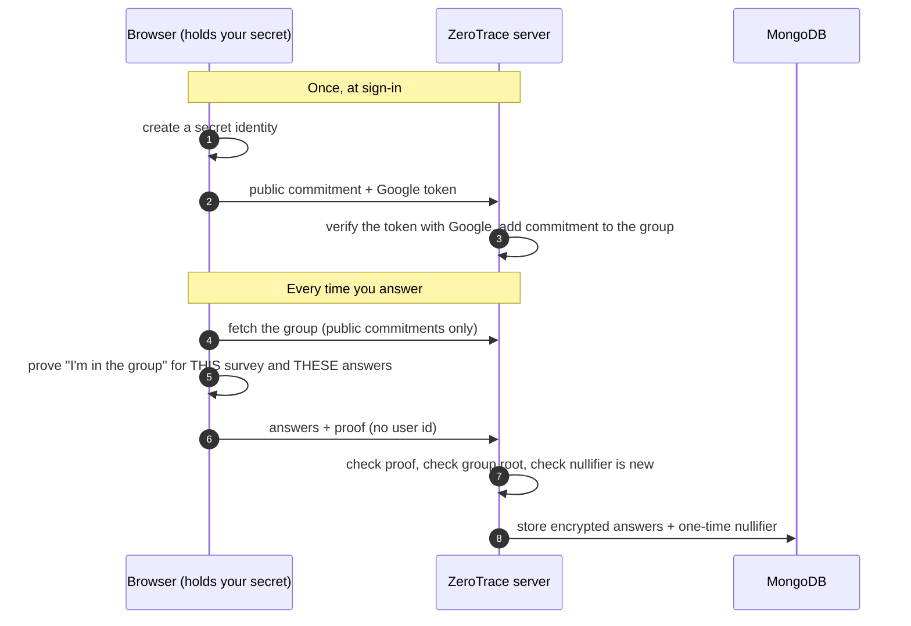
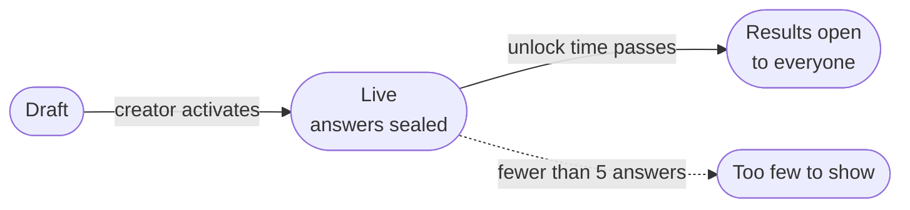

<div align="center">



<br><br>

**Anonymous surveys where nobody, including the server, can tell who said what.**<br>
Respondents prove they're a real, registered member with a zero-knowledge proof made in their own browser. Answers stay encrypted until the time you set, then the results open to everyone.

<br>


[Why](#why-zerotrace) · [See it](#see-it) · [How it works](#how-it-works) · [What's private](#whats-private-and-whats-not) · [Get started](#getting-started) · [API](#api-overview)

</div>

<br>

<div align="center">

<br>
<sub>The answer stays. The identity doesn't.</sub>
</div>

---

## Why ZeroTrace

People tell the truth when it can't be traced back to them, and most "anonymous" survey tools ask you to take that on trust. On a typical form the creator can watch answers arrive and guess who wrote what in a small group, and the tool knows exactly who you are.

ZeroTrace is built so the promise is enforced by cryptography instead of policy:

- **Nothing identifies the respondent.** The browser proves *"I'm one of the registered members"* without saying which one. The request that carries an answer contains no user id.
- **One person, one answer.** A per-survey nullifier blocks duplicates, and it can't be traced back to a person.
- **Nobody peeks.** Answers are AES-256 encrypted and sealed until the unlock time the creator chose. Not even the creator can read them early.
- **Results belong to everyone.** When a survey closes, its results open to the public as totals and percentages. Never as individual rows.

## See it

<div align="center">

<table>
  <tr>
    <td align="center" width="50%"><br><sub><b>Homepage</b> · a redacted response record</sub></td>
    <td align="center" width="50%"><br><sub><b>Surveys</b> · filter by category, results-open tags</sub></td>
  </tr>
  <tr>
    <td align="center" width="50%"><br><sub><b>Answering</b> · anonymity note, human check, one click</sub></td>
    <td align="center" width="50%"><br><sub><b>Results</b> · open to everyone once the lock passes</sub></td>
  </tr>
  <tr>
    <td align="center" width="50%"><br><sub><b>Builder preview</b> · exactly what respondents will see</sub></td>
    <td align="center" width="50%"><br><sub><b>Your surveys</b> · status, counts and next action</sub></td>
  </tr>
</table>

<sub>Screenshots use example surveys and example responses.</sub>

</div>

## Features

- **Zero-knowledge membership proofs** (Semaphore v4), generated in the browser
- **Time-locked results.** Encrypted until the creator's unlock time, then decrypted automatically
- **Public results with safety rules.** Minimum of 5 responses, totals only, written answers private unless the creator opts in
- **Proof of humanity** with reCAPTCHA before submitting
- **Survey builder** with drag-to-reorder questions, five question types and a faithful respondent preview
- **A calm, editorial interface** with no cookies, no ad trackers and no dark patterns. Visit counts are aggregate and cookie-free, and survey-answering pages are never counted

## How it works

<div align="center">

<br>
<sub>Verified, sealed, unlocked. The crowd speaks; individuals don't.</sub>
</div>

<br>

### Answering a survey



### A survey's life



1. **Join.** At first sign-in your browser creates a secret identity and registers only its *public* half. The server verifies your Google sign-in with Google itself, and each account gets exactly one identity.
2. **Prove.** To answer, the browser builds a proof that is bound to the survey and to your exact answers. It shows you're a member without revealing which one.
3. **Check.** The server verifies the proof against a known group state and records the nullifier. A second attempt from the same member produces the same nullifier and is rejected, even with a brand-new proof.
4. **Seal.** Answers are AES-256 encrypted and stored with the nullifier, never with a user id. Timestamps are rounded to the day.
5. **Open.** When the unlock time passes, results are published as aggregates. Free text stays private unless the creator opted in, because the way someone writes can identify them.

## What's private, and what's not

Honest answers need honest claims, so here is exactly what the design does and doesn't protect.

| | |
|---|---|
| ✅ **The server can't link an answer to a person** | Responses carry a proof and a one-time token, not an identity. The token can't be traced to a member without that member's secret, which never leaves their browser. |
| ✅ **Creators and the public can't see who answered** | Creators see counts. Public results are aggregates with a 5-response minimum. |
| ✅ **Nobody reads answers early** | Encrypted at rest, decrypted only after the unlock time. |
| ✅ **No double answers** | Enforced by the nullifier, in the database as well as in code. |

## Tech stack

| Layer | Choice |
|---|---|
| Frontend | React 18 (Create React App), React Router, framer-motion, hand-written CSS design system |
| Backend | Node.js, Express, Mongoose |
| Database | MongoDB (Atlas or local) |
| Zero-knowledge | [Semaphore v4](https://docs.semaphore.pse.dev/) identity, group and proof packages, snarkjs |
| Encryption | AES-256-CBC with a server-side key, unlocked by a scheduled job |
| Auth | Google OAuth, verified server-side for identity registration |

## Getting started

### Prerequisites

- Node.js 18 or newer
- A MongoDB database ([free Atlas cluster](https://www.mongodb.com/atlas) works)
- A Google OAuth client id of type *Web application*, with `http://localhost:3000` as an authorised JavaScript origin

### 1. Clone and install

```bash
git clone https://github.com/zhtHreem/zeroTrace.git
cd zeroTrace

cd backend  && npm install && cd ..
cd frontend && npm install --legacy-peer-deps && cd ..
```

### 2. Configure

Copy the example files and fill them in. The files are ignored by git, so your secrets stay local.

```bash
cp backend/.env.example  backend/.env
cp frontend/.env.example frontend/.env
```

Generate the encryption key (64 hex characters):

```bash
node -e "console.log(require('crypto').randomBytes(32).toString('hex'))"
```

<details>
<summary><b>Backend variables</b> (<code>backend/.env</code>)</summary>

| Variable | Required | Description |
|---|:--:|---|
| `MONGO_URI` | ✅ | MongoDB connection string |
| `ENCRYPTION_KEY` | ✅ | 256-bit AES key as 64 hex characters |
| `REACT_APP_API_URL` | ✅ | Frontend origin for CORS, e.g. `http://localhost:3000` (no trailing slash) |
| `GOOGLE_CLIENT_ID` | ✅ | Lets the server confirm sign-in tokens were issued to your app |
| `PORT` | | Defaults to `5000` |
| `DNS_SERVERS` | | e.g. `8.8.8.8,1.1.1.1`. Fixes `querySrv ECONNREFUSED` with `mongodb+srv://` on some networks |

</details>

<details>
<summary><b>Frontend variables</b> (<code>frontend/.env</code>)</summary>

| Variable | Required | Description |
|---|:--:|---|
| `REACT_APP_LOCAL_URL` | ✅ | Backend base URL, e.g. `http://localhost:5000` |
| `REACT_APP_GOOGLE_CLIENT_ID` | ✅ | Google OAuth client id (public by design) |
| `REACT_APP_RECAPTCHA_SITE_KEY` | | Your own reCAPTCHA v2 site key |
| `GENERATE_SOURCEMAP` | | Set to `false` for faster dev builds |

</details>

### 3. Run

```bash
# terminal 1: API on :5000
cd backend && npm run dev

# terminal 2: app on :3000
cd frontend && npm start
```

Visit counts use [Vercel Web Analytics](https://vercel.com/docs/analytics) and only do anything once deployed on Vercel with Analytics enabled for the project. Nothing is sent from your local machine.

The first build takes a minute or two. The first time you answer a survey, your browser downloads the proof parameters, so allow a few seconds.

### 4. Optional: load example surveys

```bash
cd backend
npm run seed          # six example surveys with encrypted responses
npm run seed:remove   # delete exactly what the script created
```

> **Heads up:** the seed script writes to whichever database `MONGO_URI` points at. Use a development database.

## API overview

All routes are under `/api`.

| Method | Route | Purpose |
|---|---|---|
| `POST` | `/login` | Sign in or create an account with Google details |
| `GET` | `/user/:id` | Public profile (name and join date only) |
| `POST` | `/identity/register` | Join the anonymous group (Bearer: Google access token) |
| `GET` | `/identity/group` | Public group commitments, used to build proofs |
| `GET` | `/forms` | Public, non-draft surveys |
| `POST` | `/forms` | Create a survey |
| `GET` | `/forms/:id` | One survey |
| `GET` | `/forms/user/:userId` | A creator's surveys, including drafts |
| `GET` | `/forms/user/:userId/stats` | Response counts per survey |
| `POST` | `/forms/activate/:id` | Start a survey and its time-lock |
| `POST` | `/responses` | Submit answers + zero-knowledge proof |
| `GET` | `/responses/:id` | Read your own response after unlock |
| `GET` | `/forms/:id/results` | Public aggregate results |
| `GET` | `/results/featured` | Recently opened results for the homepage |

## Acknowledgements

The anonymity design follows the [Semaphore](https://docs.semaphore.pse.dev/) protocol from Privacy & Scaling Explorations, which also underpins several proof-of-personhood systems. Survey wording follows common question-design guidance: one idea per question, neutral phrasing, fully labelled scales.
